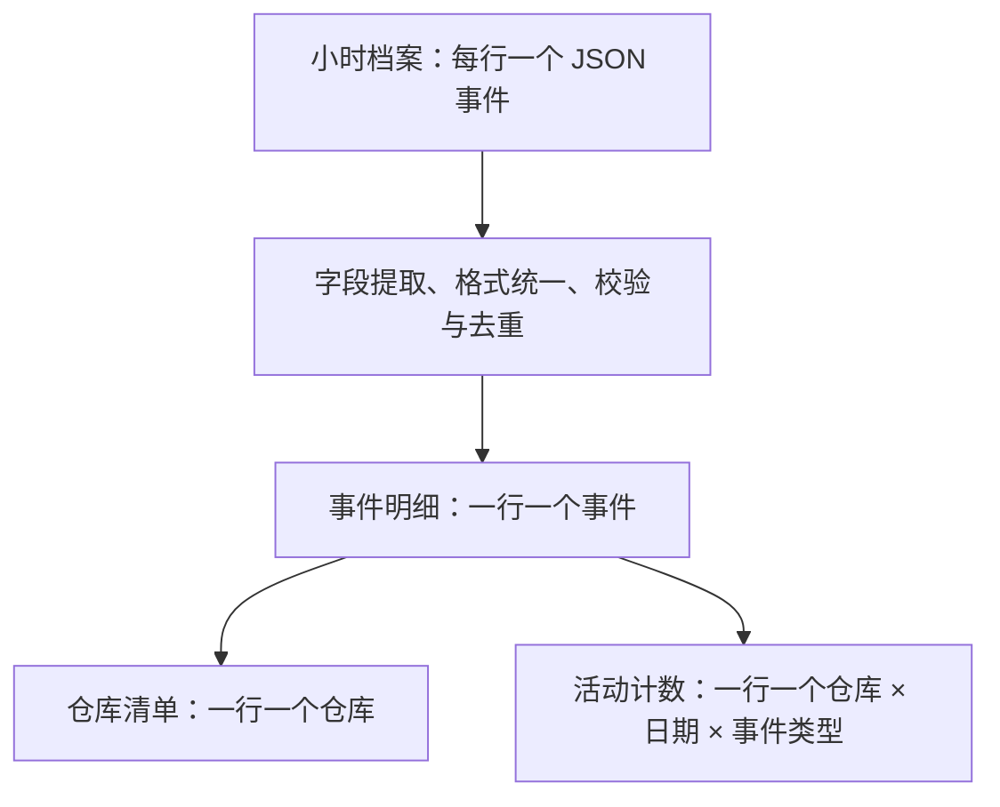

# 用一条真实记录看懂：原始数据怎么变成后续分析的数据

**完整处理细节请看 [数据处理全解（HTML）](数据处理全解.html)**，包含原始文件与处理产物分类、实际数据依赖、每一步脚本、字段来源和完整文件索引。本文保留为简短的数据介绍。

我们想研究 AI 相关仓库创建后头一年的活动变化。A 现在做的是准备基础数据：把 GitHub 公开活动记录整理成统一的事件表，再产生仓库清单和活动计数，供后续筛选、分析和并行实验使用。

**当前完成的是一个小时的真实试跑。** 数据来自 `2024-01-15-0.json.gz`，对应 UTC 00:00–01:00 的小时档案；共有 197,313 条事件，涉及 69,768 个仓库。目前的数据包括各种仓库，AI 标签需要后续由 B 补充。

## 原始数据：一行记录一次公开活动

`.gz` 表示文件被压缩。解压后的内容是许多行 JSON，每一行是一个事件对象。比如一次推送、一次 PR 相关活动、一次 Issue 相关活动或一次加星。

**一行的单位是“事件”，不是一个仓库。** 同一个仓库发生多次活动，就会出现在多行中。

下面是这个档案第一行的真实字段节选（省略其他字段）：

```json
{
  "id": "34816047159",
  "type": "PushEvent",
  "actor": {
    "id": 49699333,
    "login": "dependabot[bot]"
  },
  "repo": {
    "id": 39464018,
    "name": "apache/superset"
  },
  "created_at": "2024-01-15T00:00:00Z",
  "payload": {
    "size": 15,
    "distinct_size": 1
  }
}
```

这条记录的意思是：`dependabot[bot]` 在这个时间，对 `apache/superset` 触发了一次推送事件，事件 ID 是 `34816047159`。

| 原始字段 | 怎么理解 |
|---|---|
| `id` | 标识这一次事件，用于去重 |
| `type` | 发生了哪种活动 |
| `actor` | 谁发起活动，可能是用户或机器人 |
| `repo` | 活动发生在哪个仓库 |
| `created_at` | 这个事件的时间 |
| `payload` | 这次活动的具体详情；不同事件类型的结构不同 |

这条 PushEvent 的完整 `payload` 还有分支、提交哈希及 `commits` 数组，数组包含 15 个 commit。**当前按事件计数，它贡献 1 条 PushEvent。** 如果以后要分析 commit 数量，需要再提取详情字段并确定计数口径。

## A 做了哪些处理：把嵌套记录整理成固定字段

原始记录中的仓库和 actor 信息嵌套在对象里，`payload` 又随事件类型变化。为了让组员可以直接筛选、连接和统计，A 做了以下处理：

1. **读取和检查**：逐行解析，统计事件类型、仓库数、字段问题及时间范围。
2. **提取共同字段**：把 `repo.id`、`repo.name`、`actor.login` 等放成表格列。
3. **统一格式并清洗**：时间转为 UTC，检查关键字段，按事件 ID 去重；错误和冲突记录分别保存。
4. **补上来源信息**：记录原始文件、行号和问题标记，方便回查。
5. **从事件表生成另外两张表**：仓库清单，以及按仓库、日期、事件类型统计的活动数。

这一小时的数据都通过了当前校验，没有重复或冲突，所以清洗后仍是 197,313 条事件。完整原始 JSON 和 `payload` 保存在小时档案中，便于后续补充特征。



## 处理后有三张主要的表

### 1. 事件明细：保留每次活动

下面是 `apache/superset` 的几条真实记录，展示主要列；实际表还有仓库 ID、actor ID、来源和问题标记等列：

| `event_id` | 时间（UTC） | 仓库 | 事件类型 | actor |
|---|---|---|---|---|
| 34816047159 | 2024-01-15 00:00:00 | apache/superset | PushEvent | dependabot[bot] |
| 34816049771 | 2024-01-15 00:00:12 | apache/superset | PushEvent | dependabot[bot] |
| 34816051245 | 2024-01-15 00:00:19 | apache/superset | PullRequestEvent | dependabot[bot] |

例如，可以用这张表找一个仓库的活动时间线、按活动类型计数，或用 actor 字段区分参与者和识别机器人活动。当前所有事件类型及机器人活动都保留，后续再按研究指标筛选。

文件：`events_clean.parquet/` 和 `events_clean.csv.gz` 保存同一张完整表的两种格式；`events_preview.csv` 只展示前 100 条，方便查看。完整表共有 197,313 行。

### 2. 仓库清单：整理出样本里出现过的仓库

从事件明细中按 `repo_id` 汇总，得到 69,768 个不同仓库。比如：

| `repo_id` | 仓库名称 | 样本内事件数 | 样本内首次出现（UTC） | 样本内最后出现（UTC） |
|---|---|---:|---|---|
| 39464018 | apache/superset | 90 | 2024-01-15 00:00:00 | 2024-01-15 00:47:19 |

文件：`repo_candidates.csv`。B 可以从这张清单开始，获取仓库元数据、建立 AI 标签，再通过 `repo_id` 与事件明细连接。

这里的首见时间来自**本次样本**。仓库创建时间需要后续补充；原始事件里的 `created_at` 也表示事件发生时间。

### 3. 活动计数：把许多事件汇总成数字

按 `repo_id × UTC 日期 × event_type` 分组，把每组的事件条数数出来。这一小时产生了 84,692 个分组。

以 `apache/superset`（`repo_id=39464018`）为例，下面省略重复的仓库 ID 列：

| UTC 日期 | 事件类型 | 事件数 |
|---|---|---:|
| 2024-01-15 | PushEvent | 46 |
| 2024-01-15 | PullRequestEvent | 14 |
| 2024-01-15 | WatchEvent | 1 |

文件：`repo_daily_counts.parquet/` 和 `repo_daily_counts.csv`。

**表按日期分组，但这些数字只覆盖读取的那个小时。** 因此这里的 46 表示在 UTC 00:00–01:00 档案里观察到 46 条推送事件。要统计完整一天，需要先读取对应 24 个小时档案并检查覆盖；进一步做月度统计，还要补足所需日期。

## 这些数据怎样接上后续实验

| 后续工作 | 从现在拿到什么 | 接着做什么 |
|---|---|---|
| B：筛选 AI 仓库 | 仓库清单、稳定的 `repo_id` | 补描述、topics、仓库创建时间；建立并抽查 AI 标签 |
| C：生命周期分析 | 事件明细、活动计数和字段约定 | 结合 B 的标签与创建时间、足够长的事件数据，形成“仓库 × 创建后第几个月”的活动表，再画轨迹和分析模式 |
| D：并行实验 | 可复跑脚本、固定输入清单、已核对的 Spark 结果 | 选定同一个计算任务和计时范围，扩到多个小时文件，比较不同并行度的运行时间 |

`python/` 和 `spark/` 保存的是同一份输入经过两种计算方法得到的结果。它们已核对一致，后续分析读取其中一份即可。当前完成的是正确性验证，正式并行性能实验需要另定一致的计时范围。

当前数据可以让组员开始了解字段、开发分析原型。AI 标签、仓库创建时间和首年观察数据补齐后，才能生成项目真正要分析的生命周期轨迹。

组员可以先看[事件表前 100 条](runs/20240115_1hour_handoff/python/events_preview.csv)、[仓库清单](runs/20240115_1hour_handoff/python/repo_candidates.csv)和[活动计数](runs/20240115_1hour_handoff/python/repo_daily_counts.csv)。需要运行脚本或排查质量问题时，再看 [README](README.md) 中的代码、日志和异常文件说明。
