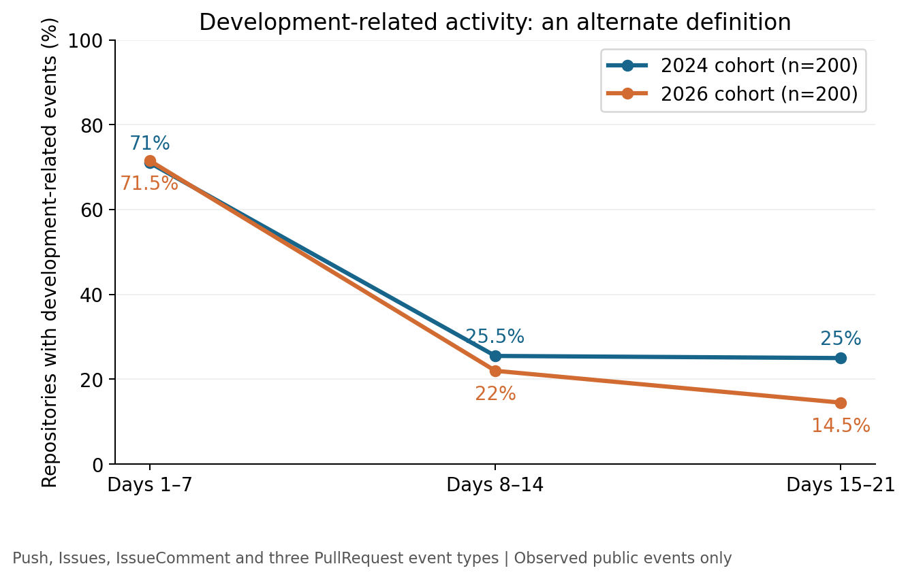
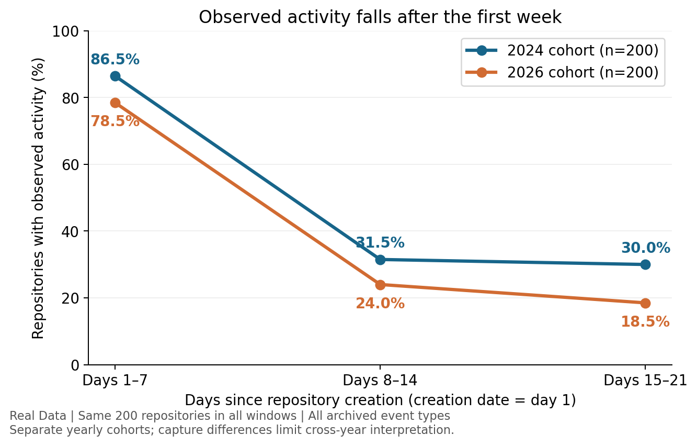
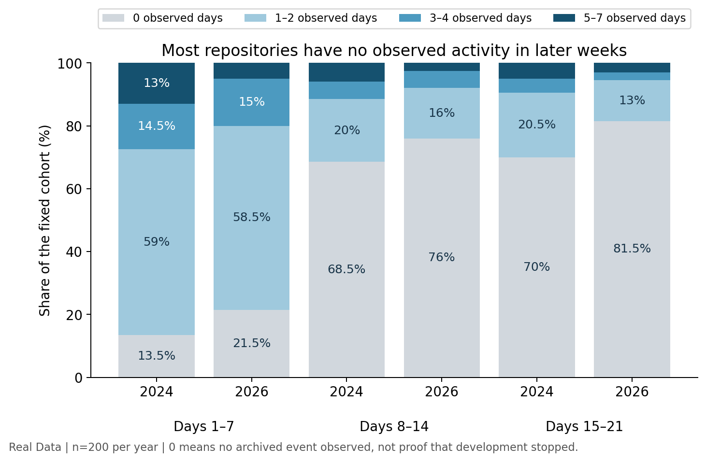
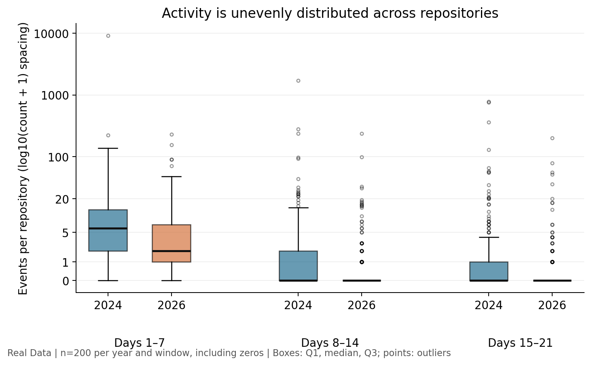

# 2024 / 2026 新建 AI 仓库前三周：真实数据分析

**现有 C 代码补跑入口：** 已补跑原 Notebook 的逐天图、描述分布及原有分阶段图。见各年 `existing_notebook_analysis/` 和 `existing_cohort_figures/`。以下较早的 `figures/04_development_active_ratio.png` 等是外部补充图，不能当成原 C Notebook 的直接输出。参考 PPT 的取舍记录见 `项目资料/04_展示准备/四分钟PPT初稿_20261114/讲稿与数据口径.md` 第 10 节。

**已使用 C 现有分析模块完成两年的真实数据计算与群体图表。每年固定 200 个仓库，每个仓库三个阶段，共输出 1,200 行仓库阶段指标。结果位于仓库外，没有推送 GitHub，也没有修改 PPT。**

研究问题：对各年 4 月 1–7 日新建且符合研究口径的这批 AI 仓库，公开活动是否集中在创建初期？之后两周还有多少仓库持续出现活动？这是固定群体的创建初期活动分析，不是完整长期生命周期或 Agent 的因果研究。

## 1. 先看结果

### 更接近开发行为的指标

开发相关事件定义为 PushEvent、IssuesEvent、IssueCommentEvent，以及 PullRequestEvent / PullRequestReviewEvent / PullRequestReviewCommentEvent。有任一上述事件即记该仓库本阶段观测到开发相关活动，分母始终为每年相同的 200 个仓库。

| 年份 | 创建后第 1–7 天 | 第 8–14 天 | 第 15–21 天 |
|---|---:|---:|---:|
| 2024 | 71% (142/200) | 25.5% (51/200) | 25% (50/200) |
| 2026 | 71.5% (143/200) | 22% (44/200) | 14.5% (29/200) |



**在本次观测样本中，首周开发活动比例接近，之后两组都明显下降。** 第三周 2024 样本为 25%，2026 样本为 14.5%。这是描述性观测结果，不能据此认定 2026 仓库实际更不活跃、Agent 降低持续性，或认定任何仓库已经死亡。

### 包含关注、创建等在内的全部公开事件

这是 C 原模块直接输出的主口径（与上面的补充开发口径分开）：

| 年份 | 第 1–7 天活跃比例 | 第 8–14 天 | 第 15–21 天 |
|---|---:|---:|---:|
| 2024 | 86.5% (173/200) | 31.5% (63/200) | 30.0% (60/200) |
| 2026 | 78.5% (157/200) | 24.0% (48/200) | 18.5% (37/200) |



## 2. 群体分布，而非只看几个个案



每根柱始终包含同一批 200 个仓库：零观测天数、1–2 天、3–4 天、5–7 天。后期零活动的仓库仍留在灰色部分，没有从分母中消失。

按全部事件口径，2024 年三个阶段事件数中位数为 **6、0、0**，2026 年为 **2、0、0**；活跃天数中位数分别为 **2、0、0** 和 **1、0、0**。后两周中位数为 0 表示至少一半仓库在该阶段未观测到事件，不等于所有仓库都不活跃。



每个箱体包含 200 个对象和零值，展示四分位数/中位数，散点为离群点。纵向间距按 log10(事件数+1) 处理，但刻度仍显示原始事件数。

三周活动轨迹补充：

- 2024 年 **40/200（20%）** 的仓库在三个阶段都至少出现过一次事件；2026 年为 **21/200（10.5%）**。这不是连续 21 天每天活跃。
- 仅第一阶段有事件（轨迹 100）：2024 年 99/200，2026 年 105/200。
- 三个阶段都未观测到事件（轨迹 000）：2024 年 19/200，2026 年 32/200。其他 101/011 等轨迹见 activity_trajectories.csv，不把 101 简化成永久停止。

## 3. 为什么不能只比较总事件数

2024 年首周总事件数为 11,845，其中 **SWE-agent/SWE-agent 占 9,039 条（76.3%）**。这 9,039 条中有 7,535 条 WatchEvent（关注/加星事件），另外还有 Fork、评论、Issue、Push 和 PR 等。总事件数混合了关注度和开发行为，也受少数热门项目支配。

因此主讲建议优先使用活跃比例、活跃天数分布和中位数，总事件数作为补充。没有因为 SWE-agent 过于活跃而把它换出固定名单；其他结果始终保留该对象。`top5_repositories_by_window.csv` 和 `swe_agent_first_week_breakdown.json` 保留具体证据。

SWE-agent 本身就在 2024 年这批新建仓库里，所以 2024 不能表述成“没有 Agent 的时期”。使用“2024 与 2026 两批新建 AI 仓库的创建初期观测活动比较”更准确。

## 4. 输入、覆盖与核对

- 每年冻结 200 个当前可检索、公开、非 fork、API 创建日期为该年 4 月 1–7 日的仓库。
- AI 范围使用 v0.3.8 初筛，经过助手文本证据复核及用户确认的范围；状态为 assistant_reviewed_user_scope，没有声称独立人工真值。
- 源日期为各年 4 月 1–27 日，648 小时档案已获取/校验。按每仓库 UTC 创建日为第 1 天，三阶段为 1–7、8–14、15–21 天。
- 每年都得到 600 行阶段表、200 个按档案覆盖判定完整的对象，缺档为 0。**档案齐全不表示 GH Archive 采集了全部 GitHub 公共活动。**
- 用独立的日期/字典聚合重算了所有仓库阶段的事件数和活跃天数，逐行与 C 模块相等；阶段汇总、固定 ID、零值保留和输入总数对账通过。

| 年份 | 日活动输入中有记录的 ID（4/1–4/27） | 输入子集事件 | 前 21 天事件 | 创建日前事件（按日期） | 第 21 天后事件 |
|---|---:|---:|---:|---:|---:|
| 2024 | 183/200 | 17,939 | 17,375 | 0 | 564 |
| 2026 | 168/200 | 2,977 | 2,863 | 0 | 114 |

2024 年有 17 个 ID 在整个源日期范围都没有记录，另有 2 个只在其第 21 天之后出现；因此前三周 000 轨迹为 19 个。没有据此删除对象或更换名单。输入子集保留了范围外的事件，C 将它们导出到 out_of_band_events.csv，阶段分析不计入。

## 5. 文件在哪里

```text
C_双年份三周真实分析_20261114/
├── README.md                              本说明与图表
├── combined_cohort_window_summary.csv      两年 × 三阶段，群体汇总
├── supplementary_metrics.csv               开发活动比例、零值数、极端值占比
├── activity_trajectories.csv                000–111 三周活动模式数量
├── top5_repositories_by_window.csv          总事件离群项目核查
├── validation.json                         独立计数、覆盖与范围核对
├── runtime_environment.json                实际运行版本
├── timings_and_inputs.json                 提取、CLI、计算耗时及来源 SHA-256
├── frozen/2024/、frozen/2026/               原样复制的固定名单与标签/元数据快照
├── 2024/                                  2026/ 相同结构
│   ├── activity_input/
│   │   ├── repo_daily_counts.csv           仅该年 200 个固定 ID 的真实日活动
│   │   ├── cohort.csv                      保留所有 ID，含无事件对象
│   │   ├── join_summary.json               提取计数、未观测 ID 与来源哈希
│   │   ├── coverage.json                   648 小时的覆盖记录
│   │   └── input_manifest.csv              原档案 URL、大小、SHA-256
│   └── analysis/
│       ├── cohort.csv
│       ├── repo_window_metrics.csv          200 × 3 = 600 行，包含零值和覆盖状态
│       ├── cohort_window_summary.csv        群体指标，每年三行
│       ├── out_of_band_events.csv           创建日前/第 21 天之后的记录
│       ├── event_type_composition.csv       三阶段的事件类型构成
│       └── analysis_summary.json            C 的输入哈希、复核来源与计算时间
├── figures/                               四种图，各有 PNG 和 SVG
├── code_snapshot/                          本次实际使用的 C 模块/CLI/依赖说明
├── tools/                                 本轮提取、独立核对与绘图脚本
└── SHA256SUMS.txt
```

## 6. 运行和计时说明

先逐批扫描两张全平台日活动 Parquet，只提取冻结 ID，再交给 C 的既有 CLI 读小型 CSV；没有把数千万行装入 pandas，也没有为读取这 400 个仓库重新获取 raw。

原 C 的 cohort_analysis.py 与 run_cohort.py 以原样快照运行。开发活动比例、轨迹、离群核查和汇总图由本轮外部辅助脚本补充，未修改仓库内的 C 代码。当前 CSV 路径实际使用 data-center 中 Python 3.11、pandas 2.2.2、NumPy 1.26.4；源 Parquet 提取使用 cs5488-data 中 PyArrow 25。CSV 路径经独立复算核对；若按项目依赖重建环境，仍建议遵循快照 requirements.txt 的 pandas>=2.3.3，避免旧 pandas 与新 PyArrow 的 Parquet 兼容问题。

实际命令和分阶段时间在 timings_and_inputs.json。两年 C 指标计算各约 0.18 秒：这只是提取后的 200 个对象，不是处理全部 54 天原始数据的耗时；本轮单次本地时间也不作为 Spark 加速比基准。Spark 的价值主要仍在更大规模事件清洗/去重/汇总，D 的正式对比应固定相同输入和任务。

## 7. 可用于 PPT 的表述

> We followed two fixed cohorts of 200 AI-related repositories through their first three weeks. Observed development activity was similar in week one, at about 71% in both cohorts, then declined in later weeks. We retained inactive repositories and verified the calculations independently. These are observed sample patterns; archive capture changes and current repository metadata limit the cross-year interpretation.

主图建议选 `04_development_active_ratio.png`，需要展示群体分布再配 `03_active_day_distribution.png`。本轮只完成三周数据，不将其称为完整 90 天生命周期；跨年事件采集差异、当前 topic/README 和助手复核范围仍需保留在图注/问答中。
